<div align="center">

#  Active Directory Home Lab
### Windows Server 2025 | Windows 11 | Group Policy | Network Security

**Building and securing a simulated enterprise Windows environment**


</div>

---

##  Project Overview

This project demonstrates the deployment, configuration, and administration of a **Windows Server 2025 Active Directory environment** using Oracle VirtualBox.

The lab simulates a fictional company called **TechNova**, consisting of four departments: IT, Human Resources, Finance, and Sales.

The goal was to build a functional corporate network, centralize user management, enforce workstation security policies, and implement departmental access restrictions.

###  Project Objectives

- Deploy Windows Server 2025 as a domain controller.
- Configure Active Directory Domain Services and DNS.
- Create and manage organizational units, users, and security groups.
- Join a Windows 11 workstation to the domain.
- Configure and verify Group Policy Objects.
- Implement departmental file sharing.
- Apply NTFS permissions using security groups.
- Test authorized and unauthorized file access.
- Document configurations and troubleshooting results.

---

##  Technologies & Tools

| Technology | Purpose |
|:---|:---|
| Windows Server 2025 | Domain controller and file server |
| Windows 11 | Domain-joined client workstation |
| Oracle VirtualBox | Virtualization environment |
| Active Directory Domain Services | Centralized identity management |
| DNS | Domain name resolution |
| Group Policy Management | Centralized workstation configuration |
| NTFS Permissions | File and folder access control |
| SMB File Sharing | Departmental network shares |
| Command Prompt | Network and security verification |

---

##  Lab Architecture

```text
                    TECHNOVA CORPORATE LAB
                   Domain: corp.technova.test
                              |
              +---------------+---------------+
              |                               |
     WINDOWS SERVER 2025                WINDOWS 11
       Domain Controller                 Workstation
              |                               |
      192.168.56.10                    192.168.56.20
              |                               |
              +------------+------------------+
                           |
                  VirtualBox Host-Only
                        Network
                           |
                  Active Directory
                           |
                        TechNova
                           |
           +---------------+---------------+
           |               |               |
          IT              HR            Finance
           |               |               |
        IT-Staff        HR-Staff      Finance-Staff
                           |
                         Sales
                           |
                       Sales-Staff
```

### Network Configuration

| Component | Configuration |
|:---|:---|
| Domain | `corp.technova.test` |
| Domain Controller | `WIN-N9SAKORTAGL` |
| Domain Controller IP | `192.168.56.10` |
| Client Workstation | `TN-WIN11-01` |
| Client IP | `192.168.56.20` |
| Network Type | VirtualBox Host-Only |

---

#  Implementation

## 01 — Windows Server Deployment

Installed Windows Server 2025 inside Oracle VirtualBox and configured the server's network interfaces.

Deployed Active Directory Domain Services and promoted the server to a domain controller for the newly created domain.

**Key configurations:**

- Windows Server 2025 installation
- Static IP configuration
- Active Directory Domain Services
- DNS server configuration
- Domain controller promotion

<details>
<summary><b> View Server Configuration Screenshots</b></summary>

<br>

Screenshots are available in the [Server Setup](01-Server-Setup/) folder.

</details>

---

## 02 — Active Directory Administration

Created the **TechNova organizational unit** and organized employee accounts into departmental OUs.

### Organizational Unit Structure

```text
corp.technova.test
│
└── TechNova
    │
    ├── IT
    │   ├── John Smith
    │   └── IT-Staff
    │
    ├── HR
    │   ├── Sarah Johnson
    │   └── HR-Staff
    │
    ├── Finance
    │   ├── Michael Brown
    │   └── Finance-Staff
    │
    ├── Sales
    │   ├── David Wilson
    │   └── Sales-Staff
    │
    └── Workstations
```

### Employee Account Management

| Department | Employee | Username | Security Group |
|:---|:---|:---|:---|
| IT | John Smith | `jsmith` | IT-Staff |
| HR | Sarah Johnson | `sjohnson` | HR-Staff |
| Finance | Michael Brown | `mbrown` | Finance-Staff |
| Sales | David Wilson | `dwilson` | Sales-Staff |

### Administrative Tasks Performed

- Created Active Directory user accounts.
- Organized users into departmental OUs.
- Created global security groups.
- Assigned users to security groups.
- Practiced password resets.
- Disabled and re-enabled user accounts.
- Verified group memberships.

<details>
<summary><b>📸 View Active Directory Screenshots</b></summary>

<br>


Additional evidence is available in the [Active Directory](02-Active-Directory/) folder.

</details>

---

## 03 — Group Policy Configuration

Configured Group Policy Objects to manage security settings across domain-joined systems.

### Workstation Security Policy

| Setting | Configuration |
|:---|:---|
| GPO Name | Workstation-Security-Policy |
| Linked OU | Workstations |
| Policy | Interactive logon: Machine inactivity limit |
| Timeout | 600 seconds |
| Equivalent | 10 minutes |

The policy was configured to lock inactive workstations after 10 minutes.

### Group Policy Verification

Executed the following command on the Windows 11 workstation:

```cmd
gpresult /r /scope computer
```

**Verified applied policies:**

```text
Applied Group Policy Objects
----------------------------
Workstation-Security-Policy
Default Domain Policy
```

This confirmed that the domain-joined workstation received the configured Group Policy Object.

<details>
<summary><b> View Group Policy Evidence</b></summary>

<br>

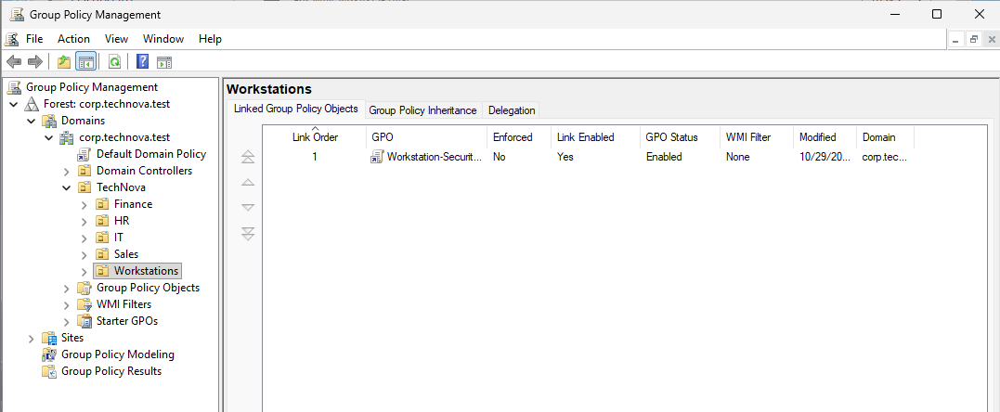

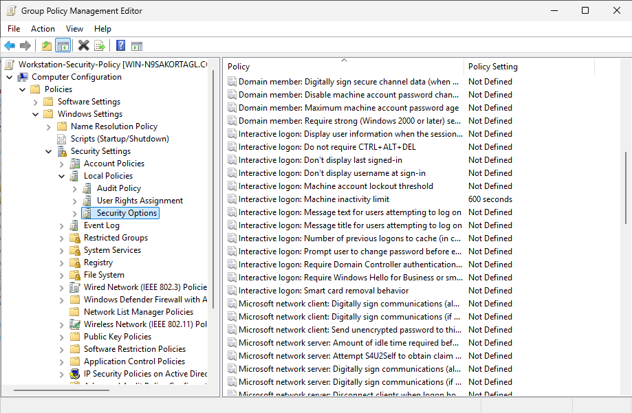

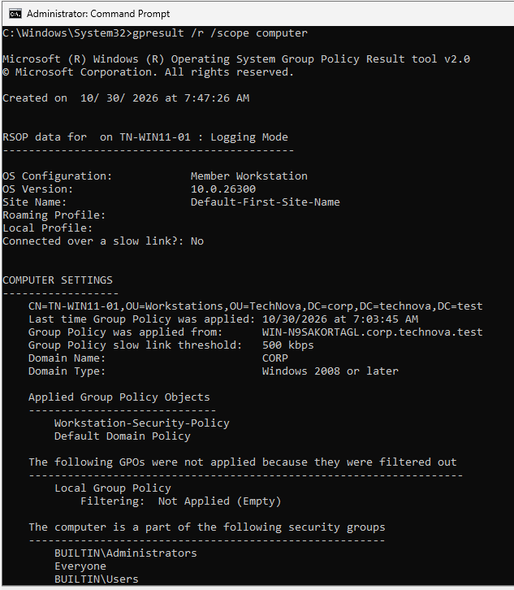

</details>

---

## 04 — Windows 11 Domain Integration

Configured a Windows 11 virtual machine and joined it to the Active Directory domain.

### Workstation Details

| Setting | Value |
|:---|:---|
| Computer Name | TN-WIN11-01 |
| Domain | corp.technova.test |
| Operating System | Windows 11 |
| IP Address | 192.168.56.20 |

### Verification

Confirmed domain membership through Windows System Properties.

Tested authentication using Active Directory employee accounts.

```cmd
whoami
```

Example result:

```text
corp\jsmith
```

<details>
<summary><b>📸 View Domain Integration</b></summary>

<br>

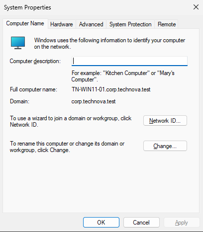

</details>

---

## 05 — File Sharing & NTFS Permissions

Created a departmental file-sharing environment on Windows Server.

### Shared Directory

```text
C:\TechNova-Shares
│
├── IT
├── HR
├── Finance
└── Sales
```

### Departmental Access Control

Configured NTFS permissions using Active Directory security groups.

| Department | Authorized Group | Access Level |
|:---|:---|:---|
| IT | IT-Staff | Modify |
| HR | HR-Staff | Modify |
| Finance | Finance-Staff | Modify |
| Sales | Sales-Staff | Modify |

Administrative accounts and SYSTEM retain Full Control.

### Parent Folder Security

Restricted the parent folder's Domain Users permissions from **Full Control** to **Read & execute**.

This reduced unnecessary access while preserving navigation to departmental folders.

**Security concepts implemented:**

- Role-Based Access Control (RBAC)
- Principle of Least Privilege
- NTFS Permission Management
- Security Group-Based Authorization

<details>
<summary><b>📸 View File Sharing and Permissions</b></summary>

<br>

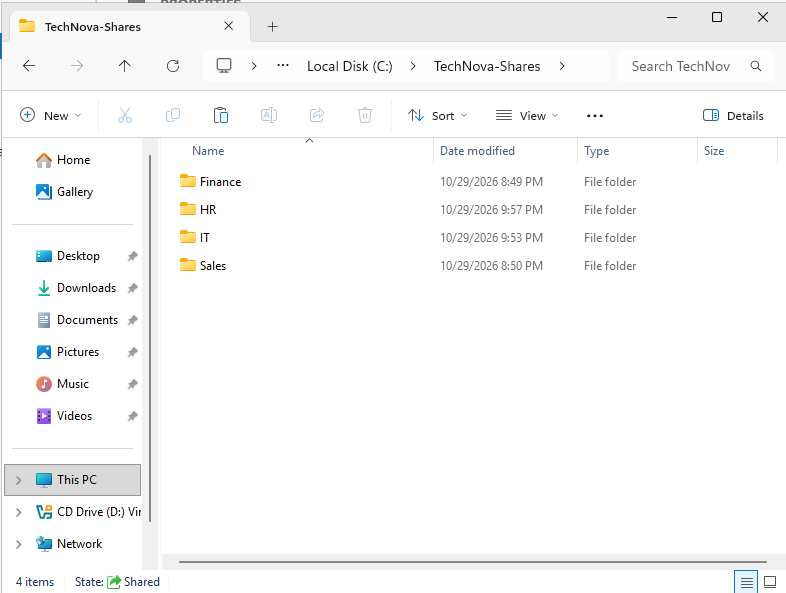

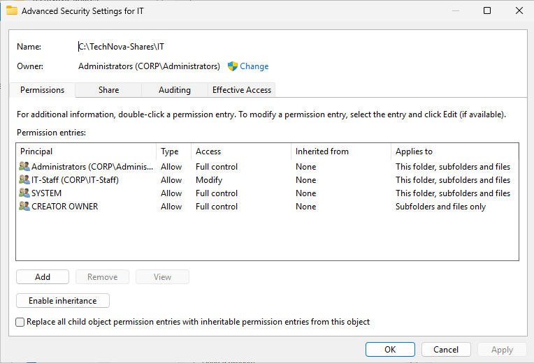

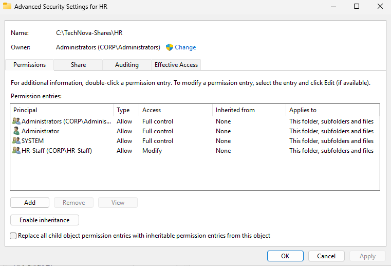

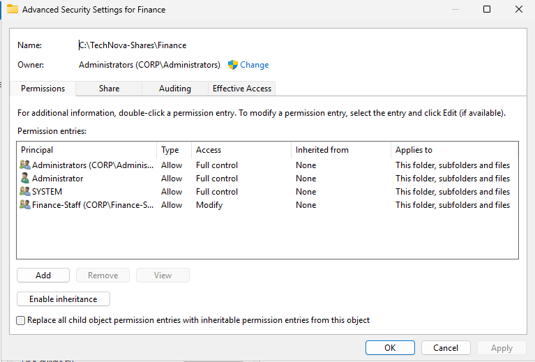

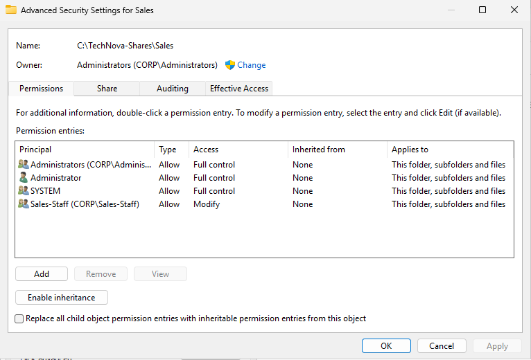


</details>

---

## 06 — Security Testing & Validation

Performed access-control testing using domain user accounts.

The objective was to verify that employees could modify files in their authorized department while unauthorized write attempts were denied.

### IT Department Testing

**Test Account:** `CORP\jsmith`

| Test | Expected Result | Actual Result | Status |
|:---|:---|:---|:---:|
| IT → IT | Allowed | Allowed |  PASS |
| IT → HR | Denied | Denied |  PASS |
| IT → Finance | Denied | Denied |  PASS |
| IT → Sales | Denied | Denied |  PASS |

### Authorized Access Test

```cmd
echo IT Access Verified > "\\192.168.56.10\TechNova-Shares\IT\IT-Final-Test.txt"
```

**Result:** File creation completed successfully.

### Unauthorized Access Test

```cmd
echo Unauthorized Access Test > "\\192.168.56.10\TechNova-Shares\HR\IT-to-HR-Test.txt"
```

**Result:**

```text
Access is denied.
```

The same restriction was verified against the Finance and Sales folders.

### Sales Department Testing

Additional testing was performed using `CORP\dwilson`.

The Sales account successfully created a file in its authorized department and was denied write access to IT, HR, and Finance.

<details>
<summary><b>📸 View Security Testing Screenshots</b></summary>

<br>

### Authorized IT Access

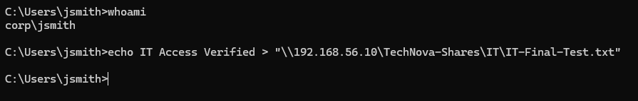

### Unauthorized HR Access


### Unauthorized Finance Access

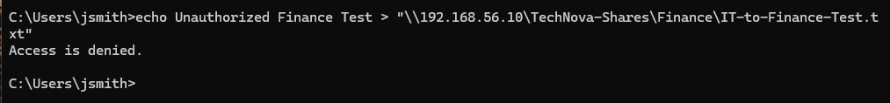

### Unauthorized Sales Access

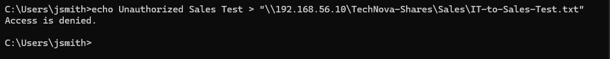

</details>

---

##  Troubleshooting & Lessons Learned

Throughout the project, I practiced troubleshooting common Windows Server and Active Directory issues.

| Challenge | Resolution |
|:---|:---|
| Virtual machines could not communicate | Reviewed VirtualBox network settings and Windows Firewall rules |
| Domain authentication and group verification | Used `whoami`, `whoami /groups`, and `net user /domain` |
| Shared folder access issues | Reviewed SMB sharing and NTFS permissions |
| Excessive parent folder permissions | Reduced Domain Users access to Read & execute |
| Group Policy verification | Used `gpresult` to confirm applied GPOs |
| Unauthorized departmental access | Tested write operations using standard domain accounts |

---

##  Skills Demonstrated

| Category | Technical Skills |
|:---|:---|
| Systems Administration | Windows Server 2025, Windows 11 |
| Identity Management | Active Directory, user accounts, security groups |
| Networking | TCP/IP, DNS, virtual networking |
| Security | RBAC, least privilege, NTFS permissions |
| Endpoint Management | Group Policy, domain integration |
| Troubleshooting | Command Prompt, network diagnostics, permission testing |
| Documentation | Technical screenshots, validation procedures, GitHub |

---

##  Repository Structure

```text
Active-Directory-Home-Lab/
│
├── 01-Server-Setup/
│
├── 02-Active-Directory/
│
├── 03-Group-Policy/
│
├── 04-Domain-Integration/
│
├── 05-File-Sharing-and-Permissions/
│
├── 06-Security-Testing/
│
└── README.md
```

---

##  Project Outcome

Successfully deployed a simulated Windows enterprise environment featuring:

- A functional Active Directory domain
- Departmental organizational units and employee accounts
- Centralized security group management
- A domain-joined Windows 11 workstation
- Applied workstation security policies
- Departmental SMB file shares
- NTFS-based access restrictions
- Verified authorized and unauthorized file operations

This project strengthened my practical understanding of **Windows Server administration, Active Directory, Group Policy, troubleshooting, and enterprise access control**.

---

<div align="center">

###  Active Directory | Windows Server | IT Administration

*Hands-on IT infrastructure and cybersecurity portfolio project*

</div>
